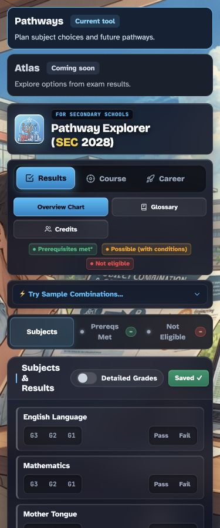

# Pathways Test and Evidence Matrix

## Current PR checks

Baseline refreshed to `edcf8e8` on 3 November 2026. The prior single-file checks
are historical and are not reused as proof for Evan’s module-based entry.

| Check | Requirement | Status |
| --- | --- | --- |
| Availability at 320, 375 and 1440 effective CSS pixels | FR-001, FR-006 | Passed local check, 2026-11-03 |
| Atlas has no action target; active module requests succeed | FR-001 | Passed local check, 2026-11-03 |
| Preset/results, Course, Career, Detailed Grades, CCA and reload | Existing regression boundary | Passed local check, 2026-11-03 |
| All upstream JS, archive, original styles/assets/config and Atlas unchanged | Scope boundary | Passed byte comparison to edcf8e8 |
| Links, manifests, task coverage and Spec Kit prerequisites | Planning consistency | Passed local check, 2026-11-03 |

The availability cards fit at effective 320/375/1440 CSS pixels and contain no Atlas
control targets. The page itself has pre-existing overflow: at 320/375 the document
is 417px wide, with `.panel-btns` / `#reset` extending beyond the viewport. This PR
changes no upstream control layout; fixing it remains UX-03 / T011. No whole-page
reflow pass is claimed. Existing preset → results, Course and Career entry, Detailed
Grades and CCA responded. Detailed mode, CCA and eight subject rows restored after
reload. Local module requests succeeded and no console errors were captured. These
are smoke checks, not independent rule or complete persistence verification.

All new implementation tasks remain planned. Export/import round trips must include
detailed-grade mode, grade/provenance, CCA, Results/Course/Career mode and selected career
cluster, not just subject rows. Persistence tests must include asynchronous IndexedDB
restore and localStorage disagreement. Grade defaults inferred from pass/fail must be
labelled as assumptions/unconfirmed, not actual entered results.

## Future journey and rule checks

| ID | Scenario and expected result | Requirement | Layer / task |
| --- | --- | --- | --- |
| R01 | All/partially unset: identify missing inputs, never assume pass/fail | FR-003 | Reviewed fixture + browser; T005, T009 |
| R02 | Reviewed mixed G1/G2/G3 combination: expected prerequisite explanation | FR-003, FR-004, FR-011 | Independent official-source fixture; T005–T006 |
| R03 | G3 fail-grade and threshold boundary: distinguish level conversion and missing subject | FR-003, FR-011 | Independent fixture; T005–T006 |
| R04 | Duplicate/science-limit/profile choice: explain school-specific scope | FR-005 | Fixture + browser; T005, T009–T011 |
| J01 | Complete/edit combination; see limits, years and source without lost state | FR-004, FR-006 | Browser; T009–T011 |
| J02 | Reverse search has no matches: explain and clear/change search | FR-007 | Browser; T012–T013 |
| J03 | Compare two options on phone; labels/actions remain attached to each | FR-006, FR-007 | Browser; T012–T013 |
| J04 | Apply suggestion, cancel/undo, return to original work | FR-007 | Browser; T012–T013 |
| F01 | Partial and complete summary: readable pages, sources/version and uncertainty | FR-008 | Browser + rendered PDF inspection; T015, T017 |
| F02 | Export/import in fresh context: canonical effective inputs and comparisons restored; implicit taken/None/stale failure fields normalised | FR-009 | Round-trip + browser; T014–T016 |
| F03 | Oversize/invalid/unknown schema, profile, subject or level: no overwrite | FR-009 | File/profile-version/adapter fixtures; T014, T016 |
| F04 | Older rules file: explicit mismatch/recalculate choice; no stale outcome | FR-009 | File + browser; T014–T016 |
| F05 | Existing Save/reload/reset, corrupt/blocked storage and cancelled import/print: truthful feedback, work retained and export usable | FR-003, FR-008, FR-009, FR-010 | Browser; T009, T011, T015–T017 |
| A01 | No login; keyboard/screen-reader labels, focus restoration and readable status | FR-002, FR-006 | Browser + assistive-tech check; T018 |
| A02 | 320/360/375/390/430/768/1440 widths; landscape, 200% text, open keyboard, Back | FR-006 | Browser + physical iOS/Android; T018 |
| P01 | Core entry/edit/import/export sends no student data over network | FR-010 | Synthetic payload inspection; T018 |
| U01 | Four of five proposed pilot users complete planning/summary and understand limits | SC-005 | Recorded pilot; T019 |

For R02/R03, do not fill expected answers from either prototype. A case needs official
reference, checked date, independently calculated outcome and named reviewer before it
is a release oracle. The current PR neither runs nor claims Atlas engine/matcher/parity
results. Existing Atlas tests are retained for later shared-rule changes.

## Later hosted measurement slice

Propose fixed events for journey start, result explanation, comparison, export success
and official-source click. Export success means the app generated a file, not proof
that the user saved/read it. Exclude subjects, grades, school, file contents, free text
and private URLs. Verify safe metadata and Enhanced Measurement settings, production
hostname gating, single events, payloads and GA Realtime/DebugView receipt. No analytics
or database is installed or activated by this PR.
